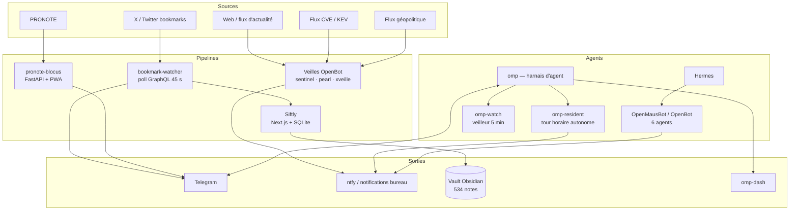
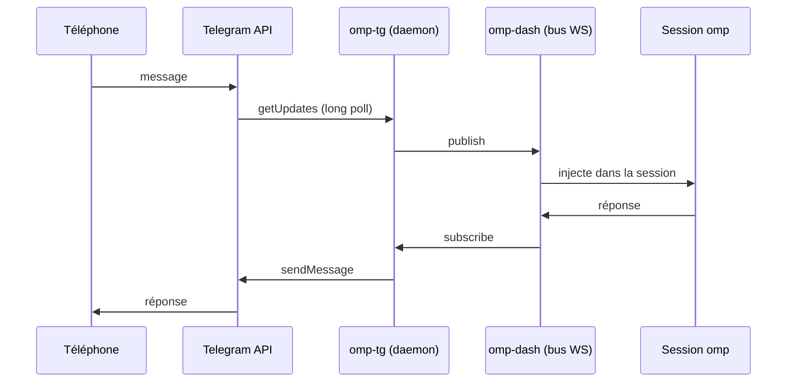
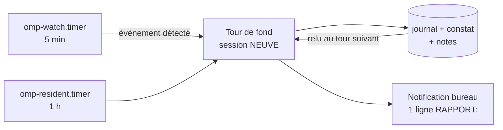
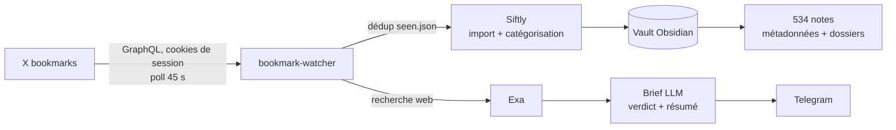

# Ma stack — agents, bots et pipelines

Documentation de l'infrastructure personnelle qui fait tourner mes agents, mes bots et mes pipelines de veille sur une machine Linux unique (Arch / Omarchy, Hyprland).

Ce dépôt ne contient **aucun secret** : pas de token, pas de clé API, pas de cookie de session. Les identifiants vivent dans des fichiers `0600` ou des variables d'environnement hors dépôt.

---

## Vue d'ensemble



---

## 1. Bots Telegram

Cinq bots BotFather, chacun dédié à un usage précis. Tous les tokens sont hors dépôt.

| Bot | Rôle | Implémentation |
|---|---|---|
| `TernOmpBot` | Canal Telegram vers une session omp vivante | Bun/TypeScript, daemon systemd, bus WebSocket `omp-dash` |
| `Bookmarks` | Notifie chaque nouveau bookmark X avec un verdict | appélé par `bookmark-watcher` |
| `whioteoutsurvival` | Bot de jeu (automatisation) | Python |
| `lightvelalala` | Bot utilitaire | Python |
| `hermes_unlaajuhruon4klj_bot` | Passerelle Hermes | Python |

**Architecture commune :** un seul consommateur `getUpdates` par bot, un seul point d'envoi (`sendMessage`). Les tokens sont lus depuis un fichier `0600` (pas d'argv, pas de log en clair).

### `omp-tg` — le pont Telegram ↔ agent



Commandes exposées : `/status`, `/use <modèle>`, `/backends`, `/abort`.

---

## 2. Agent résident autonome

Le cœur de l'infrastructure : un agent qui tourne seul, sans personne pour approuver.

### Principe : contexte neuf, mémoire fichier

Un contexte LLM qui vit des jours dérive. Un contexte qui repart de zéro et relit ses traces ne dérive pas.

- **`omp-resident`** (timer horaire) — un tour = une session **neuve**. La mémoire n'est pas dans le contexte mais dans les fichiers : journal des tours, constat précédent, notes projet.
- **`omp-watch`** (timer 5 min) — veilleur **sans modèle**. Il détecte (service mort, disque, erreur journal) et ne réveille le résident que sur événement.
- **`omp-dash`** — tableau de bord et bus d'événements (WebSocket).
- **`tern-remote`** — sessions distantes.



**Garde-fous :** ce que l'agent a le droit de faire vient d'un fichier de règles et d'un filtre sur les appels d'outils — pas du prompt. Les approbations interactives sont désactivées en fond (personne pour approuver), le filtre fait office de barrière.

**Sortie bornée :** un tour produit un fichier de tour, une ligne de journal, et **une seule** notification — celle que le modèle écrit.

---

## 3. Pipeline de sauvegarde des favoris X → Obsidian

Le pipeline complet, de la publication sauvegardée à la note Markdown : **service systemd utilisateur + bot Telegram + Siftly**.



### Régime permanent : HTTP pur

Le watcher n'utilise **pas** de navigateur en régime normal : appels HTTP directs à l'API GraphQL de X avec les cookies de session. Quelques Mo de RAM, réponse sous la seconde, poll toutes les 45 s.

Le navigateur (camoufox) ne sert qu'à deux choses :

1. le **login initial** (une seule fois, session persistée) ;
2. le **rafraîchissement de session** quand les cookies expirent (rare, automatique).

### Par nouveau bookmark

| Étape | Détail |
|---|---|
| 1. Poll | GraphQL X, intervalle configurable |
| 2. Dédup | `seen.json` — un bookmark n'est traité qu'une fois |
| 3. Import | injecté dans Siftly (déjà dédupliqué en base) |
| 4. Enrichissement | recherche web pour appuyer ou contredire |
| 5. Verdict | `GAME CHANGER` / `SOLIDE` / `MOYEN` / `BRUIT` |
| 6. Notification | Telegram : lien, verdict, résumé, fraîcheur, sources |

### Siftly — le gestionnaire de bookmarks

Application **local-first** : Next.js 16, SQLite via Prisma, export Obsidian.

- catégorisation automatique par thème
- génération de notes Markdown avec front-matter
- export vers le vault, dossiers par auteur ou par catégorie
- fact-checking via un proxy LLM local

### Le vault Obsidian

- **534 notes** de bookmarks dans `Bookmarks/`
- **1 318 notes** Markdown au total dans le vault
- front-matter par note : `tweet_id`, `title`, `author`, `author_name`, `date`, `url`, `source`, `categories`, `tags`, `permalink`
- dossiers dérivés : `author/<handle>`, `category/<slug>`

Extrait de front-matter réel :

```yaml
---
tweet_id: '1850000000000000003'
title: Testing Siftly import pipeline E2E
author: '@importtest'
author_name: Import Test
date: 2026-09-08
url: https://x.com/importtest/status/1850000000000000003
source: bookmark
categories:
  - Dev Tools & Engineering
tags:
  - twitter/bookmark
  - author/importtest
  - category/dev-tools-engineering
permalink: bookmarks/cmtsusj0p0002esqe2o4ls7gt
---
```

### Services systemd impliqués

| Unité | Rôle | Déclenchement |
|---|---|---|
| `bookmark-watcher.service` | daemon de poll + analyse | continu |
| `bookmark-watcher-morning.service` | digest quotidien + veille proactive | timer |
| `bookmark-watcher-weekly.service` | récap hebdomadaire | timer |
| `siftly.service` | application de gestion (port local) | continu |

---

## 4. Veilles thématiques

Trois agents de veille, chacun avec son collecteur et son timer. Chaque tick collecte, puis pousse une notification.

| Veille | Sujet | Sortie |
|---|---|---|
| **Sentinel** | cyber — CVE, KEV | ntfy + notification bureau |
| **Pearl** | géopolitique | ntfy + notification bureau |
| **Xveille** | écosystème Hermes / Nous | ntfy + notification bureau |

Chaîne : `openbot-veille-tick <agent>` → collecte → `openbot-veille-notify-ntfy --send`.

Points d'ingénierie appris à la dure :

- **ne jamais tronquer un lot pour le faire tenir dans la limite de transport puis acquitter le lot entier** — le contenu coupé est perdu silencieusement. On rend des identifiants, on n'embarque que ce qui tient **entier**, on n'acquitte que ce qui est parti ;
- un élément « émis mais jamais confirmé livré » se reprend comme **vu**, pas comme à rejouer ;
- un collecteur doit viser le fichier d'état qui **existe réellement**, pas la version précédente.

---

## 5. Agents locaux (OpenBot / OpenMausBot)

Six agents déclarés, avec routines planifiées et mémoires propres.

| Agent | Rôle |
|---|---|
| **Xveille** | veille écosystème |
| **Sentinel** | veille cyber |
| **Pearl** | veille géopolitique |
| **Hermes** | assistant général |
| **Pote** | assistant scolaire |
| **Maire** | agent local |

Le déclenchement passe par un serveur d'automation local : l'application expose un endpoint et un jeton dans un répertoire de configuration ; un script poste un payload borné (4000 caractères) et reçoit un accusé de réception.

---

## 6. Applications

| Application | Stack | Rôle |
|---|---|---|
| **pronote-blocus** | Python/FastAPI + PWA + bot Telegram | liste du travail à rattraper après une absence, en lecture seule |
| **Siftly** | Next.js 16, Prisma, SQLite | gestionnaire de bookmarks, export Obsidian |
| **bookmark-watcher** | Python | collecte X, analyse, notification |
| **omp-dash** | Bun/TypeScript | tableau de bord des agents |
| **tern-remote** | Rust | sessions distantes |

### Principe commun à pronote-blocus

Aucune réponse ne dépend du LLM. Chaque fonction a un **repli déterministe**, et aucune exception ne traverse l'API. Les valeurs de repli ne sont jamais écrites en cache — sinon le cache se fige sur du dégradé. Un disjoncteur mémoire évite de refaire des timeouts à chaque affichage quand le service LLM est mort.

---

## 7. Infrastructure machine

- **Arch Linux / Omarchy**, Hyprland, configuration en Lua
- **44 services utilisateur** actifs (dont plusieurs timers)
- conteneurs : serveur photo auto-hébergé (Immich, PostgreSQL, ML, Redis)
- stockage : deux NVMe, une clé USB de sauvegarde, un volume de vaults

---

## Ce que ce dépôt n'est pas

Ce n'est pas une distribution ni un produit. C'est la carte d'une installation personnelle : elle documente des choix, pas des garanties.

Trois principes qui reviennent partout dans cette stack :

1. **fail-closed** — dans le doute, on refuse et on le dit nommément, plutôt que de produire une réponse plausible mais fausse ;
2. **contexte neuf, mémoire fichier** — un agent qui repart de zéro et relit ses traces est plus fiable qu'un contexte long qui dérive ;
3. **une sortie bornée** — un tour, un rapport, une notification. Pas de flux continu illisible.
